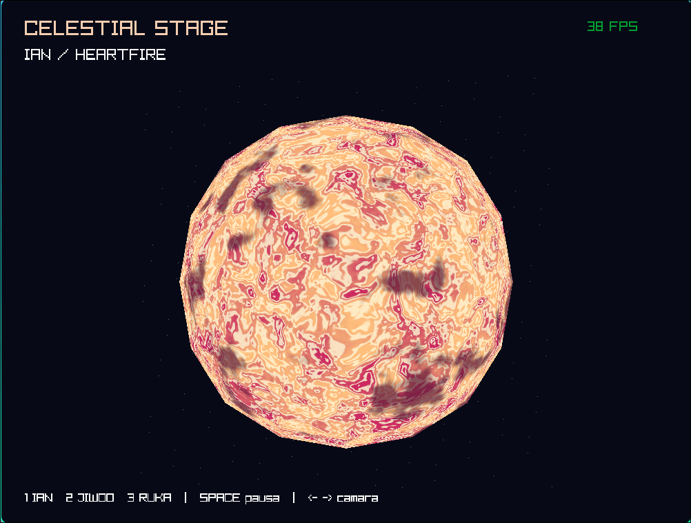
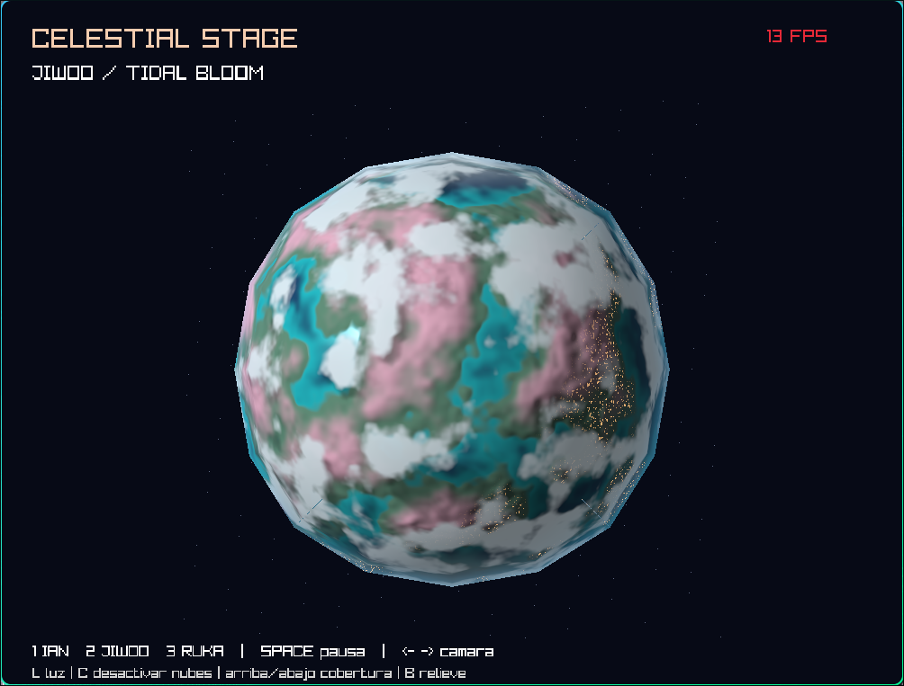
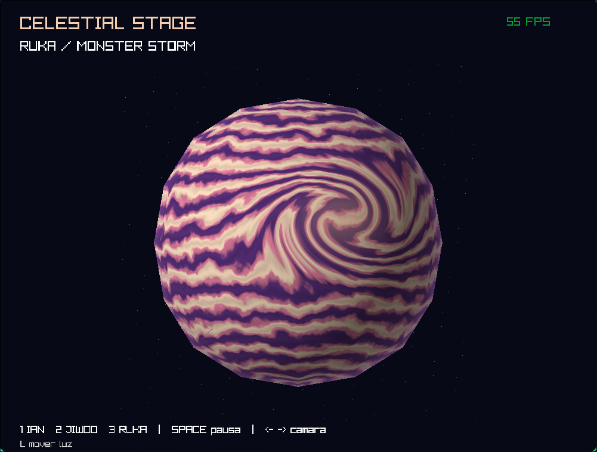

# Lab 6: Shaders

Tres cuerpos celestes de fantasía: **Ian**, una estrella; **Jiwoo**, un planeta rocoso; y **Ruka**, un gigante gaseoso.

La rasterización y los fragment shaders se ejecutan en **CPU**. Los tres cuerpos utilizan la misma geometría de `src/sphere.obj`, sin desplazar vértices ni agregar modelos para los detalles. Las superficies se generan con funciones matemáticas, ruido, máscaras y cálculos de iluminación; no se cargan imágenes como texturas ni materiales externos. Raylib se utiliza para la ventana, los controles y la presentación del framebuffer final.

## Ejecutar

Requisitos: Rust estable compatible con edition 2024, Cargo, compilador C/C++, CMake, libclang y dependencias de escritorio de raylib/GLFW. En Debian/Ubuntu, si faltan:

```bash
sudo apt install build-essential cmake libclang-dev pkg-config libx11-dev libxrandr-dev libxi-dev libxcursor-dev libxinerama-dev libgl1-mesa-dev
```

Compilar y ejecutar desde la raíz del repositorio:

```bash
cargo build --release
cargo run --release
```

La primera compilación necesita acceso a Internet para descargar las dependencias.

| Control | Acción |
|---|---|
| 1 / 2 / 3 | Ian / Jiwoo / Ruka |
| Espacio | Pausar tiempo del material |
| Flechas izquierda / derecha | Mover la cámara alrededor del cuerpo inmóvil |
| L (mantener) | Cambiar dirección de luz (Jiwoo y Ruka) |
| C | Activar/desactivar nubes y sus sombras (solo Jiwoo) |
| Arriba / abajo | Aumentar / reducir cobertura nubosa (Jiwoo, con nubes activadas) |
| B | Activar/desactivar bump mapping (solo Jiwoo) |
| Esc | Salir |

## Ian · Heartfire — estrella



Una fotosfera coral con celdas doradas, filamentos crema y manchas magenta oscuras. En `src/shaders.rs`, `star` combina ruido fractal de cuatro octavas, deformación de dominio, una onda de valor absoluto y una máscara suave de manchas. El ruido desplaza las coordenadas de otro ruido. La estrella es emisiva y no depende de luz externa. El tiempo altera las celdas, filamentos y manchas con la malla inmóvil.

Parámetros: frecuencia `11.` para tamaño de celdas; `warp*3.` para turbulencia; `n*24.` para densidad de filamentos; umbrales `0.56, 0.7` para manchas. `Params.time` anima el material. Aumentar frecuencia produce estructuras más pequeñas.

## Jiwoo · Tidal Bloom — planeta rocoso



Océanos profundos y costas turquesa rodean continentes verdes y rosados con hielo polar. `rocky` utiliza `height` (fBm 3D) como máscara de tierra y profundidad costera. Una segunda escala de ruido produce luces nocturnas. Las nubes blancas son una mezcla del mismo fragment shader, sin otra esfera. La coordenada nubosa gira con el tiempo mientras el terreno permanece fijo.

El océano tiene un reflejo Blinn-Phong de exponente `95.`, los continentes son mates. El gradiente de altura se estima con seis muestras centradas (`e=0.007`); se proyecta sobre el plano tangente y perturba la normal, sin desplazar vértices. Las nubes proyectan sombras muestreando **la misma máscara** hacia la luz a una altura aproximada de `0.065`. La distancia tangencial aumenta cuando la luz baja; se limita cerca del terminador para evitar singularidades. Es una aproximación local de capa, no trazado volumétrico.

Parámetros: `height` escala `3.3` controla distribución continental; transición `0.44–0.48` controla costa; `Params.bump` controla relieve; `Params.coverage` es el umbral nuboso (menor umbral = más nubes); escala `6.` controla tamaño nuboso; velocidad `0.045` controla deriva independiente. La intensidad de sombra es `0.48`. Las luces se apagan en el día usando el producto normal·luz y una transición suave.

## Ruka · Monster Storm — gigante gaseoso



Bandas violeta, coral y crema con filamentos y una tormenta localizada. `gas` convierte la posición a longitud/latitud, calcula una distancia elíptica al centro de tormenta y **rota esas coordenadas** con un ángulo que decae exponencialmente. Después calcula las bandas en las coordenadas deformadas: las franjas se curvan al acercarse al vórtice. El color del núcleo es secundario; el efecto viene de la deformación.

Las bandas mezclan una onda latitudinal, fBm y una ondulación longitudinal animada. `smooth` evita escalones de color y da transiciones fluidas. Parámetros: `lat*32.` controla cantidad de bandas, `flow*6.` ondulación, `3.4` fuerza del vórtice, centro `(0.35,0.17)`, radios `(0.5,0.32)`, y escala `110.` de filamentos. La tormenta está situada en el hemisferio visible inicialmente. Aumentar fuerza curva más las bandas.

## Evidencia de los efectos implementados

[Video de demostración — 48.85 segundos](video/planetas.mp4)

Referencias aproximadas dentro de la grabación: Ian es visible en **00:00–00:07**, Jiwoo en **00:12–00:30** y Ruka en **00:38–00:48**. El video muestra animación del material, cambios de iluminación y distintas vistas. Las capturas de cada cuerpo aparecen en las secciones anteriores.

| Efecto solicitado | Cuerpo y ubicación en el código | Funcionamiento y parámetro modificable | Evidencia |
|---|---|---|---|
| Material animado | Ian; [`src/shaders.rs`](src/shaders.rs), `star` | El tiempo modifica las coordenadas del ruido y la deformación de dominio. Evolucionan plasma, filamentos y manchas con la geometría inmóvil. El factor `t * 0.2` controla parte de la velocidad de evolución: aumentarlo acelera el cambio. | [Video, 00:00–00:07](video/planetas.mp4#t=0,7). Observar las manchas y filamentos. |
| Apariencia de día y noche | Jiwoo; [`src/shaders.rs`](src/shaders.rs), `rocky`, bloque `city` | Ruido de frecuencia `170.` forma puntos cálidos sobre tierra. La máscara `1 - smooth(0., 0.22, n.dot(u.light))` los apaga progresivamente al recibir luz. El umbral `0.22` controla el ancho de esa transición. | [Video, 00:23–00:30](video/planetas.mp4#t=23,30). Observar las luces en la región nocturna. |
| Respuestas diferentes a la iluminación | Jiwoo; [`src/shaders.rs`](src/shaders.rs), `rocky`, bloques `land`, `half` y `spec` | El océano recibe reflejo Blinn-Phong y la tierra iluminación mate. `1 - land` restringe el reflejo al agua. El exponente `95.` controla su concentración: bajarlo ensancha el brillo. | [Video, 00:12–00:30](video/planetas.mp4#t=12,30). Comparar los brillos del océano con los continentes al cambiar la luz. |
| Nubes procedurales | Jiwoo; [`src/shaders.rs`](src/shaders.rs), `cloud` y mezcla final de `rocky` | Una máscara de fBm se evalúa en coordenadas rotadas con el tiempo y se mezcla con la superficie, en la misma esfera. `Params.coverage=0.48` es el umbral: reducirlo aumenta las nubes. `0.045` controla su movimiento independiente del terreno. | [Captura de Jiwoo](imagenes/image-2.png) y [video, 00:12–00:23](video/planetas.mp4#t=12,23). Arriba/abajo ajusta cobertura; C alterna nubes y sombras. |
| Tormenta o vórtice localizado | Ruka; [`src/shaders.rs`](src/shaders.rs), `gas`, bloques `r`, `angle`, `lon` y `lat` | La distancia elíptica al centro controla una rotación de coordenadas que curva las bandas antes de calcular su color. La fuerza `3.4` aumenta o reduce el giro; los radios `0.5` y `0.32` cambian su extensión. | [Captura de Ruka](imagenes/image-3.png) y [video, 00:38–00:48](video/planetas.mp4#t=38,48). Seguir las bandas al entrar en la tormenta. |
| Relieve procedural mediante bump mapping | Jiwoo; [`src/shaders.rs`](src/shaders.rs), `height` y `rocky`, bloques `grad` y `bn` | Se toman seis muestras del campo de altura para estimar la pendiente. Su componente tangencial modifica la normal de iluminación sobre tierra, sin mover vértices. `Params.bump=0.12` controla la intensidad; B alterna entre ese valor y cero. | [Video de Jiwoo con cambios de luz, 00:12–00:30](video/planetas.mp4#t=12,30). El relieve es suave; para una comparación directa en la aplicación, quitar nubes con C, pausar con Espacio y alternar B mientras se mantiene L para mover la luz. |
| Sombras de nubes | Jiwoo; [`src/shaders.rs`](src/shaders.rs), `cloud` y bloque `shadow_p` de `rocky` | Se consulta la misma máscara nubosa, con el mismo tiempo, en una posición desplazada hacia la luz. La nube correspondiente oscurece la superficie. `0.065` controla la altura aproximada y separación de la sombra; `0.48` controla su intensidad. | [Video, 00:12–00:23](video/planetas.mp4#t=12,23). Observar las zonas oscuras junto a las nubes al variar la iluminación. En la aplicación, usar L con las nubes activadas. |
